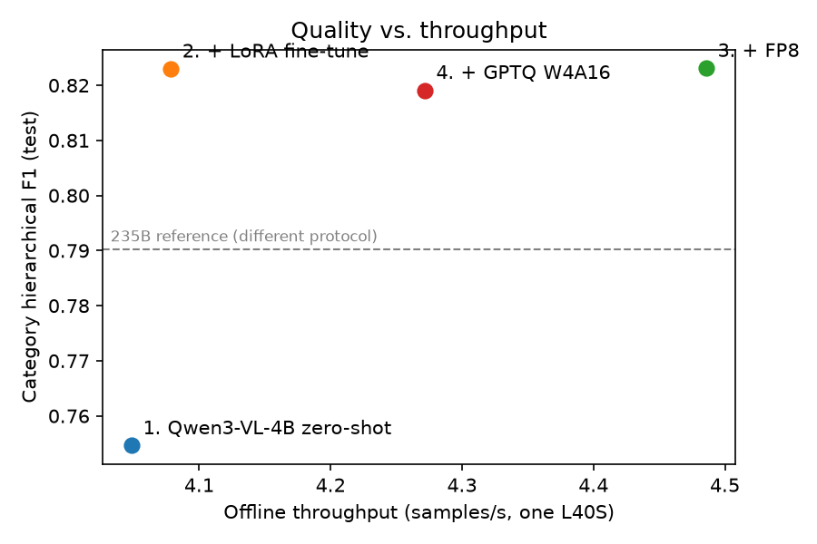

# Post-train, quantize and serve a 4B vision-language model on Shopify's catalogue benchmark

**Question.** Can a small open model (Qwen3-VL-4B), fine-tuned and quantized, match a much larger one on Shopify's public product-categorisation task, and what does quantization actually buy when it is served?

**Answer.** Yes on quality: LoRA fine-tuning lifts category hierarchical F1 from 0.755 to 0.823 on a held-out test set, above the 0.790 that MLCommons reports for Qwen3-VL-235B. FP8 quantization loses no measurable quality, cuts weight memory by 40% and sustains 23% more load under the benchmark's latency limit. 4-bit GPTQ cuts weight memory by 60% for a 0.4-point F1 loss, but is no faster under load.

| Model | Hier. F1 (95% CI) | Weights in GPU memory | Offline samples/s | Server QPS (p99 ≤ 12 s) |
|---|---|---:|---:|---:|
| 1. Qwen3-VL-4B zero-shot | 0.755 (0.748–0.762) | 8.44 GiB | 4.05 | 2.02 |
| 2. + LoRA fine-tune | 0.823 (0.817–0.829) | 8.44 GiB | 4.08 | 2.02 |
| 3. + FP8 | 0.823 (0.817–0.829) | 5.07 GiB | 4.49 | 2.49 |
| 4. + GPTQ W4A16 | 0.819 (0.813–0.825) | 3.35 GiB | 4.27 | 2.02 |
| Reference: Qwen3-VL-235B (cited) | 0.790 | | | |

Quality: held-out test split, 9,658 examples. Serving: validation split (2,000 examples), one NVIDIA L40S, vLLM 0.34.0, identical launch flags for every row.



## What was done

- **Task.** Given a product's title, description, image and 8–9 candidate categories, return the category path, brand and second-hand flag as JSON. Dataset: [`Shopify/product-catalogue`](https://huggingface.co/datasets/Shopify/product-catalogue). Prompt, output schema and scorer come from the MLCommons inference reference implementation (`multimodal/qwen3-vl`).
- **Fine-tuning.** LoRA (r=16) on the language model, one epoch over 36,631 training examples, 11.9 GPU-hours. The checkpoint was chosen on validation; the test set was read once, at the end.
- **Quantization.** llm-compressor: FP8 (no calibration) and GPTQ 4-bit weights (256 calibration examples). The vision tower and output head stay in full precision.
- **Serving.** vLLM with a load generator written for this project that follows the benchmark's Offline scenario (throughput) and Server scenario (Poisson arrivals, highest rate with p99 latency ≤ 12 s).

This follows the benchmark's task and scenario definitions; it is not an MLPerf submission.

## Limitations

1. **Not the official protocol.** The 0.790 reference was measured on the official test set with the official harness; these numbers use a re-split of the public data, so the comparison is indicative.
2. **One training run.** A single learning rate and seed; run-to-run variance is not measured.
3. **Serving is prompt-bound and hardware-specific.** Prompts average 2,300 tokens (mostly image) against 40 output tokens, so the GPU spends its time reading prompts. This limits how much weight quantization can speed things up, and the serving numbers hold for one L40S.

Details, the image ablation, an error review and what did not work are in [REPORT.md](REPORT.md).

## Reproduce

```bash
pip install -e .                                   # plus vllm in a separate environment for serving
python scripts/make_splits.py                      # frozen splits, checked by hash
python -m src.train_sft --name sft_lr1e-4 --lr 1e-4 --epochs 1
python scripts/merge_lora.py <adapter_dir> models/row2
python -m src.quantize --model models/row2 --scheme fp8   --out models/row3_fp8
python -m src.quantize --model models/row2 --scheme w4a16 --out models/row4_w4a16
scripts/run_serving.sh models/row2 row2_sft val 2.0   # Offline + scoring + Server search
python scripts/analyze.py --split test --serving-split val --rows row1=row1_zeroshot row2=row2_sft row3=row3_fp8 row4=row4_w4a16 --ablation row2_textonly
```

Every number in the table is generated by `scripts/analyze.py` from the raw outputs in `results/`.
